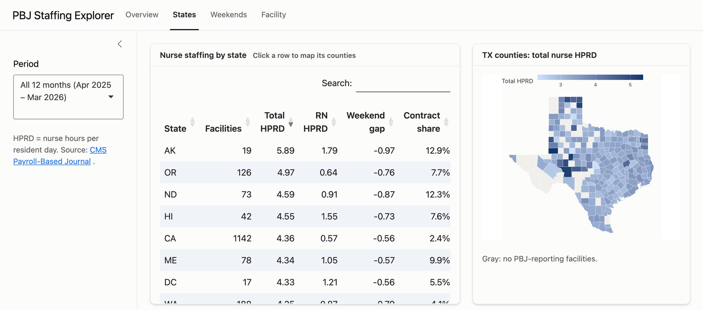

# PBJ Staffing Explorer

How well staffed are U.S. nursing homes, and how much of that staffing comes from agency (contract) workers?

**[▶ Live dashboard](https://danielleburr.shinyapps.io/pbj-staffing-explorer/)**

[](https://danielleburr.shinyapps.io/pbj-staffing-explorer/?tab=States)

This project turns CMS's public **Payroll-Based Journal (PBJ)** data into a small analytics stack:

- **Pipeline:** finds the latest quarterly files in the CMS catalog, downloads them, and builds a DuckDB warehouse with tested SQL models
- **Dashboard:** an R Shiny app with national trends, a state table with county maps, a weekday-vs-weekend comparison, and a drill-down into any of ~15,000 facilities

## The data

[PBJ Daily Nurse Staffing](https://data.cms.gov/quality-of-care/payroll-based-journal-daily-nurse-staffing) is payroll-based staffing data that every Medicare/Medicaid-certified nursing home must submit to CMS. Each row is one facility on one day. It contains the resident census and the hours worked by RNs, LPNs and nurse aides, split into employee hours and contract hours. CMS releases one file per quarter, about 1.3M rows each.

### Metrics

| Metric | Definition |
|---|---|
| **Total nurse HPRD** | (RN + LPN + nurse aide hours) ÷ resident days |
| **RN HPRD** | RN hours (incl. Director of Nursing and RN admin) ÷ resident days |
| **Contract share** | Contract hours ÷ total nurse hours |
| **Weekend HPRD** | Total nurse HPRD limited to Saturdays and Sundays |

HPRD = hours per resident day. Every ratio is computed as `sum(hours) / sum(resident days)` at the grain being displayed, never as an average of daily or facility ratios. See [docs/decisions.md](docs/decisions.md).

## Architecture

```
data.cms.gov catalog ──► pipeline/run_pipeline.R ──► data/pbj.duckdb ──► app_data/*.parquet ──► app.R (Shiny)
   (quarterly CSVs)         R/warehouse.R + sql/*.sql    (~385 MB, local)   (~5 MB, committed)
```

| Model | Grain | Purpose |
|---|---|---|
| `stg_pbj_daily` | facility × day | Typed, renamed, hours grouped into RN / LPN / aide, employee vs. contract |
| `dim_facility` | facility | Latest name and location for each facility |
| `fct_facility_month` | facility × month | Summed hours and resident days (zero-census days excluded) |
| `agg_state_month` | state × month | State rollup for the dashboard |
| `agg_county_month` | state × county × month | County rollup for the county map |

Everything except `stg_pbj_daily` is exported to `app_data/` as Parquet and committed, so the deployed app needs no pipeline run or database server.

## Dashboard

| Tab | What it shows |
|---|---|
| [**Overview**](https://danielleburr.shinyapps.io/pbj-staffing-explorer/?tab=Overview) | National HPRD, RN HPRD, weekend gap and contract share, plus monthly trends |
| [**States**](https://danielleburr.shinyapps.io/pbj-staffing-explorer/?tab=States) | Sortable state table; click a state to map its counties |
| [**Weekends**](https://danielleburr.shinyapps.io/pbj-staffing-explorer/?tab=Weekends) | Weekday vs. weekend staffing for every state, sorted by the size of the drop |
| [**Facility**](https://danielleburr.shinyapps.io/pbj-staffing-explorer/?facility=075338) | Any facility's staffing and contract share against its state average |

Links can open a tab (`?tab=Weekends`) or a facility by CMS provider number (`?facility=075338`).

## Running it

Requires R ≥ 4.2.

```r
install.packages(c("duckdb", "DBI", "dplyr", "jsonlite", "shiny", "bslib", "DT", "ggplot2", "ggiraph", "maps", "testthat"))
```

```bash
Rscript -e 'shiny::runApp()'           # launch the dashboard (uses committed app_data/)
Rscript pipeline/run_pipeline.R        # optional: rebuild from the latest 4 CMS quarters
Rscript -e 'testthat::test_dir("tests/testthat")'
SHINYAPPS_ACCOUNT=<account> Rscript deploy.R   # deploy app.R, R/ and app_data/ only
```

## Roadmap

- [x] **Phase 1: Pipeline.** Catalog-driven download, DuckDB models, tests on a hand-calculated fixture
- [x] **Phase 2: Dashboard.** Overview, States (with county map), Weekends and Facility tabs, hover tooltips throughout, [deployed to shinyapps.io](https://danielleburr.shinyapps.io/pbj-staffing-explorer/)
- [ ] **Phase 3: Validation.** Reconcile against CMS's published Provider Information staffing figures and document any differences
- [ ] **Phase 4: Write-up.** Findings, plus how I used Claude Code as a development partner

## About

Built by [Danielle Davis](https://www.linkedin.com/in/danielle-davis-560152142/). The patterns here (migrating BI dashboards to code, checking numbers against the source, server-side filtering for large dropdowns, Slack-delivered reports) come from my work as a business intelligence analyst in healthcare staffing.
